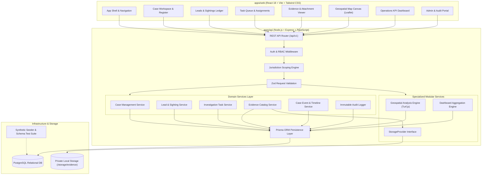

# TraceGrid — Architecture Specification & System Design

## 1. Architectural Overview

TraceGrid is an **Investigation Operations Dashboard** designed as a **Modular Monolith**. It provides an integrated, audit-logged workspace for coordinating case management, officer assignments, witness leads and sightings, controlled evidence, operational deadlines, and geospatial search hypotheses.

The core architecture prioritizes:
- **Strict Separation of Concerns:** Core case management is insulated from specialized calculations (geospatial algorithms), private binary file storage, and dashboard analytical aggregations.
- **Authoritative Backend:** The Node.js/Express backend serves as the sole arbiter of domain invariants, role-based access control, jurisdiction scoping, state machine transitions, and immutable audit trails.
- **Explainable Decision Support:** Geospatial analysis produces candidate search hypotheses with transparent assumptions and explicit uncertainty boundaries; it does not present predictions as factual certainties.
- **Synthetic-First Data Strategy:** All developmental and demonstrative operations use realistic fictional scenarios to guarantee ethical privacy standards.

---

## 2. Component Subsystems and Boundaries

The application is decomposed into ten distinct functional subsystems:

### 2.1 Subsystem Responsibilities

| Subsystem | Primary Responsibilities | Boundaries & Constraints |
|---|---|---|
| **1. React Frontend & Modules** | Renders high-contrast operational UI, handles state caching, route navigation, and interactive mapping. | No direct database access; executes zero state transitions without API authorization. |
| **2. Express REST API** | Exposes `/api/v1` routes, manages HTTP request lifecycles, and standardizes JSON error/success envelopes. | Stateless transport layer; delegates business logic to domain services. |
| **3. Auth & Authorization Middleware** | Verifies JWT tokens, resolves actor identity, enforces Role-Based Access Control (RBAC). | Rejects unauthenticated or unauthorized requests prior to controller execution. |
| **4. Domain Services & Validation** | Executes case transitions, assignment logic, invariant checks, and validates payloads using Zod schemas. | Contains pure business logic; unaware of HTTP request/response objects. |
| **5. Prisma Persistence Layer** | Type-safe query building, relational joins, transactional atomicity, and schema migrations. | Isolated from file storage and coordinate geometry calculations. |
| **6. PostgreSQL Database** | ACID-compliant relational storage, foreign keys, unique constraints, and JSONB representations. | Authoritative repository of structured investigation records. |
| **7. Private Storage Provider** | Manages file bytes on disk behind an abstract interface (`StorageProvider`), computes SHA-256 hashes, enforces MIME policies. | File bytes are never stored in PostgreSQL; access is authenticated and streamed. |
| **8. Geospatial Analysis Service** | Ingests observations, computes convex hulls / uncertainty buffers, calculates search hypotheses with explainable assumptions. | Independent from case workflows; can be tested or swapped without altering case management. |
| **9. Dashboard Aggregation Engine** | Executes live aggregate SQL queries for operational KPIs, attention queues, and overdue task metrics. | Hardcoded dashboard metrics are strictly prohibited. |
| **10. Seed & Test Infrastructure** | Provides deterministic, reproducible synthetic datasets (30–50 cases, 100–200 leads, 50–100 tasks) and automated validation scripts. | Must never import or reference real sensitive personal data. |

---

## 3. Separation of Concerns & Isolation Mechanisms

### 3.1 Isolating Case Management from Geospatial Analysis
The Case Management service manages case lifecycle states (`REPORTED` -> `UNDER_REVIEW` -> `OPEN` -> `CLOSED`), officer accountability, and lead tracking. It treats location observations merely as associated evidence records. 

The **Geospatial Analysis Engine** operates as an independent decision-support service:
- It takes an array of normalized location observations (coordinates, timestamps, uncertainty radiuses, and source types) as inputs.
- It produces candidate `SearchZoneHypothesis` records containing GeoJSON polygons and explanatory rationale.
- If the geospatial algorithm is modified (e.g., from minimum bounding geometry to velocity-constrained bounding), the core case management state machines remain completely untouched.

### 3.2 Isolating File Storage from Evidence Metadata
Evidence records are split into two decoupled concepts:
1. **`EvidenceItem` (PostgreSQL):** Stores business metadata, legal chain of custody, provenance, recording timestamp, access classification, and parent case/lead links.
2. **`Attachment` (PostgreSQL + Local Disk):** PostgreSQL stores the file reference, original filename, MIME type, byte size, SHA-256 hash, and an opaque storage key (`UUIDv4`). The raw binary bytes reside in a restricted filesystem folder outside the web root (`storage/evidence/<storage_key>`).
- Files cannot be accessed through public URLs.
- Retrieval requires passing through `/api/v1/attachments/:id/content`, which enforces user permissions and jurisdiction scoping.

### 3.3 Isolating Reporting & Aggregation from Core Operations
Dashboard metrics (open cases, unassigned leads, overdue tasks) are computed via dedicated read-optimized queries rather than mutating operational records. Overdue status is an operational indicator evaluated dynamically at query time (`due_date < NOW() AND status != 'COMPLETED'`), preventing race conditions and silent state corruption.

---

## 4. Technology Decisions and Stack Rationalization

- **PostgreSQL + Prisma:** PostgreSQL provides industrial-grade reliability, relational integrity, and robust JSONB support for geospatial geometry. Prisma guarantees TypeScript type safety across queries and schema migrations.
- **Relational Coordinates over PostGIS in v1:** 
  For the prototype, storing `latitude`, `longitude`, and `location_uncertainty_meters` in validated `Float` fields and geometries in `JSONB` eliminates complex external spatial extension requirements on development machines while fully supporting Turf.js calculations.
- **PostGIS Future Migration Path:**
  The schema and API contracts are structured so that converting `latitude`/`longitude` to `geography(Point, 4326)` and `geometry_geojson` to `geography(Polygon, 4326)` in a future checkpoint requires only a targeted Prisma migration, leaving business contracts intact.
- **Turf.js:** Provides client- and server-compatible, deterministic 2D spherical mathematics (buffering, convex hull, distance, bounding box) that are easily unit-tested.
- **Leaflet:** Lightweight, performant, mobile-friendly mapping library with proven open-source raster and vector support.
