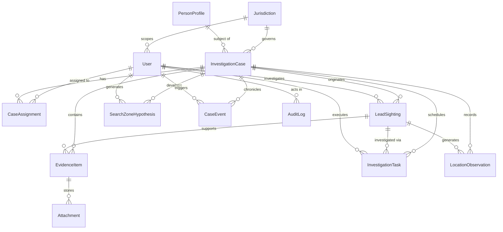
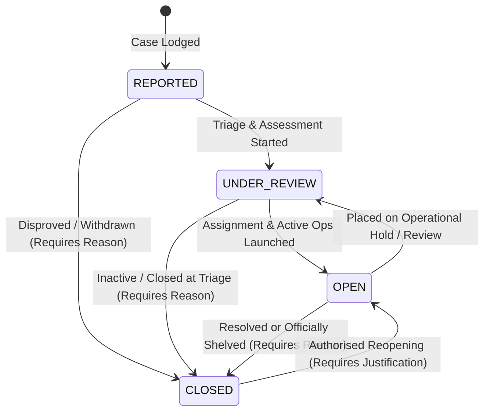
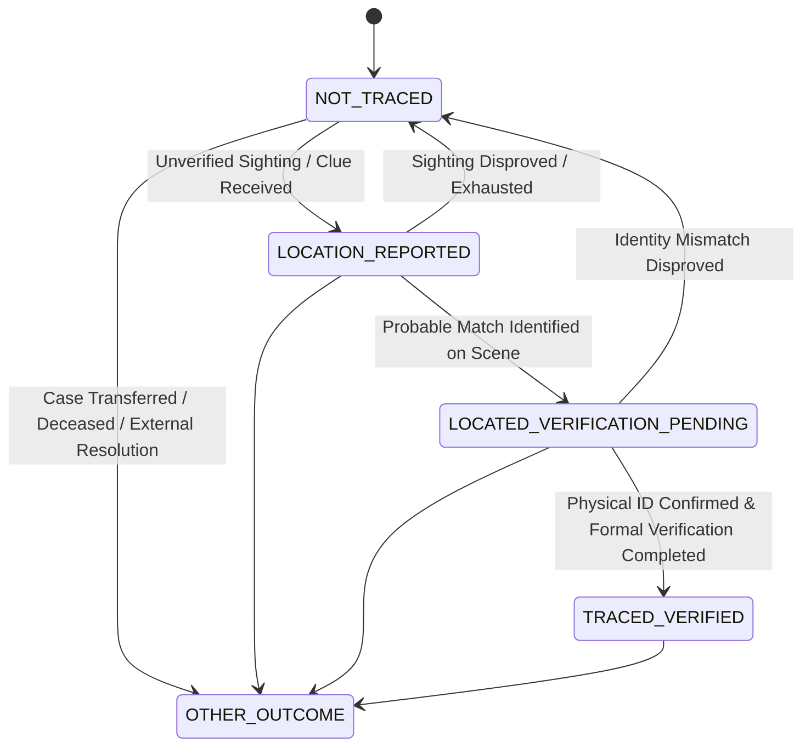
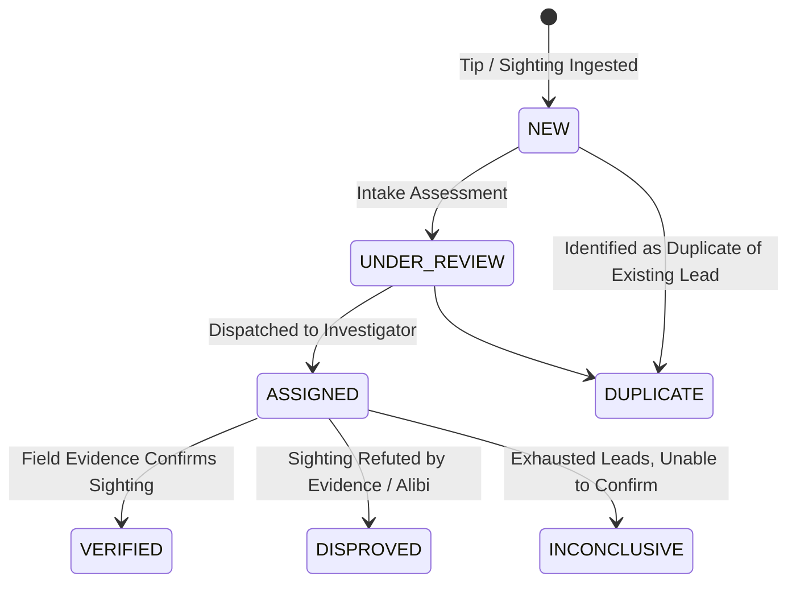
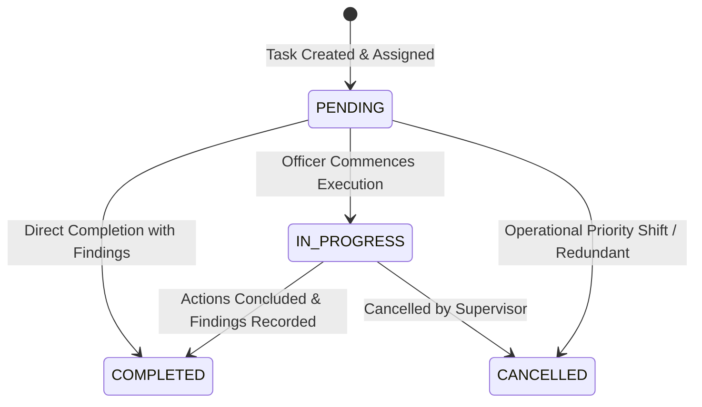

# TraceGrid — Canonical Data Model & Relational Design

## 1. Data Model Principles and Conventions

- **Primary Identifiers:** Universally Unique Identifiers (UUIDv4) represented as standard 36-character hyphenated strings across PostgreSQL (`UUID`) and TypeScript (`string`).
- **Temporal Handling:** All timestamps are stored in UTC (`TIMESTAMP WITH TIME ZONE` in PostgreSQL) and serialized as ISO-8601 strings (`YYYY-MM-DDTHH:mm:ss.sssZ`). Event timestamps (when an incident occurred) are strictly distinguished from recording timestamps (when data entered TraceGrid).
- **Referential Integrity:** Enforced via foreign key constraints. Cascade deletions are restricted on critical operational records; deleting a case or person is prohibited if dependent evidence or assignments exist.
- **Audit Logging Isolation:** Audit logs and case events are append-only. They are never updated or deleted.
- **Geospatial Storage in v1:** Latitude and longitude are stored as validated IEEE 754 64-bit floating point numbers (`Double Precision`), with associated uncertainty in meters. Complex geometries (polygons) are stored as validated GeoJSON in `JSONB` fields.
- **Sensitivity Classification:** Every entity is annotated with a sensitivity tier (`INTERNAL`, `RESTRICTED`, `CONFIDENTIAL`).

---

## 2. Entity-Relationship Overview

---

## 3. Entity Catalog and Schema Specifications

### 3.1 `Jurisdiction`
Represents an administrative or territorial operational jurisdiction (e.g., district, zone, division) within the prototype.

| Field | SQL Type | Prisma Type | Nullable | Default | Description |
|---|---|---|---|---|---|
| `id` | `UUID` | `String` | No | `uuid()` | Primary Key |
| `code` | `VARCHAR(32)` | `String` | No | None | Unique alphanumeric code (e.g. `JUR-NORTH-01`) |
| `name` | `VARCHAR(128)` | `String` | No | None | Full human-readable jurisdiction name |
| `region` | `VARCHAR(64)` | `String` | No | None | State / Regional administration boundary |
| `is_active` | `BOOLEAN` | `Boolean` | No | `true` | Operational status of the jurisdiction |
| `created_at` | `TIMESTAMPTZ` | `DateTime` | No | `now()` | Record creation timestamp |
| `updated_at` | `TIMESTAMPTZ` | `DateTime` | No | `now()` | Last modification timestamp |

- **Constraints & Indexes:** `UNIQUE (code)`, `INDEX (region, is_active)`
- **Sensitivity:** `INTERNAL`
- **Deletion Policy:** Prohibited if associated with active users or cases (`RESTRICT`).

---

### 3.2 `User`
Authorized system operator with credentials, role, and jurisdiction scoping.

| Field | SQL Type | Prisma Type | Nullable | Default | Description |
|---|---|---|---|---|---|
| `id` | `UUID` | `String` | No | `uuid()` | Primary Key |
| `email` | `VARCHAR(255)` | `String` | No | None | Unique email / login identifier |
| `display_name` | `VARCHAR(128)` | `String` | No | None | Full name of investigator / officer |
| `badge_number` | `VARCHAR(32)` | `String` | Yes | `null` | Optional departmental service number |
| `password_hash` | `VARCHAR(255)` | `String` | No | None | Argon2id / bcrypt salted hash |
| `role` | `VARCHAR(32)` | `RoleEnum` | No | None | `CASE_OFFICER`, `SUPERVISOR`, `DATA_CLERK`, `SYSTEM_ADMIN`, `READ_ONLY_REVIEWER` |
| `jurisdiction_id`| `UUID` | `String` | Yes | `null` | Scoped jurisdiction (null for global `SYSTEM_ADMIN`) |
| `is_active` | `BOOLEAN` | `Boolean` | No | `true` | Account activation flag |
| `last_login_at` | `TIMESTAMPTZ` | `DateTime` | Yes | `null` | Timestamp of last authenticated session |
| `created_at` | `TIMESTAMPTZ` | `DateTime` | No | `now()` | Account creation timestamp |
| `updated_at` | `TIMESTAMPTZ` | `DateTime` | No | `now()` | Account modification timestamp |

- **Foreign Keys:** `jurisdiction_id` -> `Jurisdiction(id)` ON DELETE RESTRICT
- **Constraints & Indexes:** `UNIQUE (email)`, `INDEX (role, is_active)`, `INDEX (jurisdiction_id)`
- **Sensitivity:** `CONFIDENTIAL` (Credentials and personal attributes)

---

### 3.3 `PersonProfile`
Demographic and descriptive profile of a subject in an investigation. Decoupled from the case itself.

| Field | SQL Type | Prisma Type | Nullable | Default | Description |
|---|---|---|---|---|---|
| `id` | `UUID` | `String` | No | `uuid()` | Primary Key |
| `synthetic_id` | `VARCHAR(32)` | `String` | No | None | Fictional public identity code (e.g. `SYN-PER-2026-0041`) |
| `full_name` | `VARCHAR(128)` | `String` | No | None | Subject's documented name |
| `aliases` | `TEXT[]` | `String[]` | No | `{}` | Known aliases or nicknames |
| `estimated_age` | `INTEGER` | `Int` | Yes | `null` | Approximate age at disappearance (1–120) |
| `birth_date` | `DATE` | `DateTime` | Yes | `null` | Confirmed date of birth if known |
| `biological_sex` | `VARCHAR(16)` | `SexEnum` | No | `UNKNOWN` | `MALE`, `FEMALE`, `NON_BINARY`, `UNKNOWN` |
| `identifying_features` | `TEXT` | `String` | Yes | `null` | Scars, marks, tattoos, medical conditions |
| `primary_photo_key` | `VARCHAR(128)` | `String` | Yes | `null` | Controlled photo reference key |
| `created_at` | `TIMESTAMPTZ` | `DateTime` | No | `now()` | Record creation timestamp |
| `updated_at` | `TIMESTAMPTZ` | `DateTime` | No | `now()` | Record modification timestamp |

- **Constraints & Indexes:** `UNIQUE (synthetic_id)`, `INDEX (full_name)`
- **Sensitivity:** `RESTRICTED` (Personal descriptive data)
- **Deletion Policy:** Prohibited if linked to any `InvestigationCase`.

---

### 3.4 `InvestigationCase`
The central operational aggregate root representing an active or historical investigation.

| Field | SQL Type | Prisma Type | Nullable | Default | Description |
|---|---|---|---|---|---|
| `id` | `UUID` | `String` | No | `uuid()` | Primary Key |
| `case_reference` | `VARCHAR(32)` | `String` | No | None | Human-readable case code (e.g. `CAS-2026-0012`) |
| `person_profile_id`| `UUID` | `String` | No | None | Reference to missing person subject |
| `jurisdiction_id` | `UUID` | `String` | No | None | Governing administrative jurisdiction |
| `reported_at` | `TIMESTAMPTZ` | `DateTime` | No | None | Timestamp when case was formally lodged |
| `missing_since` | `TIMESTAMPTZ` | `DateTime` | No | None | Estimated timestamp when subject went missing |
| `case_state` | `VARCHAR(32)` | `CaseStateEnum` | No | `REPORTED` | `REPORTED`, `UNDER_REVIEW`, `OPEN`, `CLOSED` |
| `tracing_outcome` | `VARCHAR(32)` | `OutcomeEnum` | No | `NOT_TRACED` | `NOT_TRACED`, `LOCATION_REPORTED`, `LOCATED_VERIFICATION_PENDING`, `TRACED_VERIFIED`, `OTHER_OUTCOME` |
| `priority` | `VARCHAR(16)` | `PriorityEnum` | No | `MEDIUM` | `LOW`, `MEDIUM`, `HIGH`, `CRITICAL` |
| `incident_summary`| `TEXT` | `String` | No | None | Initial narrative of disappearance circumstances |
| `last_activity_at`| `TIMESTAMPTZ` | `DateTime` | No | `now()` | Timestamp of most recent significant activity |
| `closed_at` | `TIMESTAMPTZ` | `DateTime` | Yes | `null` | Timestamp when case was closed |
| `closure_reason` | `TEXT` | `String` | Yes | `null` | Formal justification for case closure |
| `created_at` | `TIMESTAMPTZ` | `DateTime` | No | `now()` | System ingestion timestamp |
| `updated_at` | `TIMESTAMPTZ` | `DateTime` | No | `now()` | Last record modification timestamp |

- **Foreign Keys:**
  - `person_profile_id` -> `PersonProfile(id)` ON DELETE RESTRICT
  - `jurisdiction_id` -> `Jurisdiction(id)` ON DELETE RESTRICT
- **Constraints & Indexes:** `UNIQUE (case_reference)`, `INDEX (jurisdiction_id, case_state)`, `INDEX (tracing_outcome)`, `INDEX (priority)`, `INDEX (last_activity_at)`
- **Sensitivity:** `RESTRICTED`

---

### 3.5 `CaseAssignment`
Temporal record tracking investigative responsibility and historical assignments.

| Field | SQL Type | Prisma Type | Nullable | Default | Description |
|---|---|---|---|---|---|
| `id` | `UUID` | `String` | No | `uuid()` | Primary Key |
| `case_id` | `UUID` | `String` | No | None | Case under investigation |
| `user_id` | `UUID` | `String` | No | None | Assigned investigator / officer |
| `assignment_role` | `VARCHAR(32)` | `AssignRoleEnum`| No | `PRIMARY_OFFICER`| `PRIMARY_OFFICER`, `ASSISTING_OFFICER`, `SUPERVISING_OFFICER` |
| `assigned_at` | `TIMESTAMPTZ` | `DateTime` | No | `now()` | Start timestamp of responsibility |
| `unassigned_at` | `TIMESTAMPTZ` | `DateTime` | Yes | `null` | Relinquishment timestamp (null if current) |
| `reassignment_reason`| `TEXT` | `String` | Yes | `null` | Reason for transfer or closure of assignment |
| `is_active` | `BOOLEAN` | `Boolean` | No | `true` | Computed/maintained flag for active assignment |
| `created_at` | `TIMESTAMPTZ` | `DateTime` | No | `now()` | Record creation timestamp |

- **Foreign Keys:**
  - `case_id` -> `InvestigationCase(id)` ON DELETE CASCADE
  - `user_id` -> `User(id)` ON DELETE RESTRICT
- **Constraints & Indexes:** `INDEX (case_id, is_active)`, `INDEX (user_id, is_active)`
- **Sensitivity:** `INTERNAL`

---

### 3.6 `LeadSighting`
Discrete investigative tip, sighting, or potential clue requiring verification.

| Field | SQL Type | Prisma Type | Nullable | Default | Description |
|---|---|---|---|---|---|
| `id` | `UUID` | `String` | No | `uuid()` | Primary Key |
| `lead_reference` | `VARCHAR(32)` | `String` | No | None | Unique lead identifier (e.g. `LEAD-2026-0089`) |
| `case_id` | `UUID` | `String` | No | None | Associated parent case |
| `source_type` | `VARCHAR(32)` | `LeadSourceEnum`| No | None | `CITIZEN_TIP`, `WITNESS_STATEMENT`, `OFFICER_PATROL`, `CCTV_REVIEW`, `SYNTHETIC_TELCO`, `SYNTHETIC_FINANCIAL` |
| `source_contact` | `TEXT` | `String` | Yes | `null` | Encrypted/controlled source contact information |
| `narrative` | `TEXT` | `String` | No | None | Detailed description of the lead / sighting |
| `observed_at` | `TIMESTAMPTZ` | `DateTime` | Yes | `null` | Alleged timestamp of occurrence |
| `reported_at` | `TIMESTAMPTZ` | `DateTime` | No | `now()` | Timestamp when reported into the system |
| `latitude` | `DOUBLE PRECISION`| `Float` | Yes | `null` | Sighting latitude (-90.0 to 90.0) |
| `longitude` | `DOUBLE PRECISION`| `Float` | Yes | `null` | Sighting longitude (-180.0 to 180.0) |
| `location_uncertainty_meters` | `DOUBLE PRECISION` | `Float` | Yes | `null` | Estimated radius uncertainty in meters |
| `location_description` | `TEXT` | `String` | Yes | `null` | Textual description of landmark/street |
| `verification_status` | `VARCHAR(32)` | `LeadStatusEnum`| No | `NEW` | `NEW`, `UNDER_REVIEW`, `ASSIGNED`, `VERIFIED`, `DISPROVED`, `INCONCLUSIVE`, `DUPLICATE` |
| `assigned_user_id` | `UUID` | `String` | Yes | `null` | Officer assigned to investigate this lead |
| `findings` | `TEXT` | `String` | Yes | `null` | Documented investigative conclusion |
| `created_at` | `TIMESTAMPTZ` | `DateTime` | No | `now()` | Record creation timestamp |
| `updated_at` | `TIMESTAMPTZ` | `DateTime` | No | `now()` | Record update timestamp |

- **Foreign Keys:**
  - `case_id` -> `InvestigationCase(id)` ON DELETE CASCADE
  - `assigned_user_id` -> `User(id)` ON DELETE SET NULL
- **Constraints & Indexes:** `UNIQUE (lead_reference)`, `INDEX (case_id, verification_status)`, `INDEX (assigned_user_id)`
- **Sensitivity:** `RESTRICTED`

---

### 3.7 `EvidenceItem`
Cataloged evidentiary item associated with a case and optionally tied to a specific lead.

| Field | SQL Type | Prisma Type | Nullable | Default | Description |
|---|---|---|---|---|---|
| `id` | `UUID` | `String` | No | `uuid()` | Primary Key |
| `evidence_reference`| `VARCHAR(32)` | `String` | No | None | Unique reference (e.g. `EVD-2026-0043`) |
| `case_id` | `UUID` | `String` | No | None | Associated investigation case |
| `lead_id` | `UUID` | `String` | Yes | `null` | Optional supporting lead association |
| `evidence_type` | `VARCHAR(32)` | `EvidenceTypeEnum`| No| None | `PHYSICAL`, `DIGITAL_IMAGE`, `CCTV_FOOTAGE`, `DOCUMENT`, `FORENSIC_REPORT`, `TRANSCRIPT` |
| `title` | `VARCHAR(128)` | `String` | No | None | Brief descriptive title |
| `description` | `TEXT` | `String` | No | None | Detailed description and context |
| `source_provenance`| `TEXT` | `String` | No | None | Origin, chain of custody, and collecting officer |
| `recorded_at` | `TIMESTAMPTZ` | `DateTime` | No | `now()` | Date logged into the system |
| `event_timestamp` | `TIMESTAMPTZ` | `DateTime` | Yes | `null` | Timestamp when evidence was captured/created |
| `access_classification`| `VARCHAR(16)`| `ClassEnum` | No | `INTERNAL` | `INTERNAL`, `RESTRICTED`, `CONFIDENTIAL` |
| `is_verified` | `BOOLEAN` | `Boolean` | No | `false` | Chain of custody verification flag |
| `created_at` | `TIMESTAMPTZ` | `DateTime` | No | `now()` | Record creation timestamp |
| `updated_at` | `TIMESTAMPTZ` | `DateTime` | No | `now()` | Record update timestamp |

- **Foreign Keys:**
  - `case_id` -> `InvestigationCase(id)` ON DELETE CASCADE
  - `lead_id` -> `LeadSighting(id)` ON DELETE SET NULL
- **Constraints & Indexes:** `UNIQUE (evidence_reference)`, `INDEX (case_id, evidence_type)`, `INDEX (lead_id)`
- **Sensitivity:** `RESTRICTED` / `CONFIDENTIAL`

---

### 3.8 `Attachment`
Binary file associated with an `EvidenceItem`. Stores file metadata and checksum; raw file resides on disk.

| Field | SQL Type | Prisma Type | Nullable | Default | Description |
|---|---|---|---|---|---|
| `id` | `UUID` | `String` | No | `uuid()` | Primary Key |
| `evidence_item_id` | `UUID` | `String` | No | None | Associated evidence record |
| `storage_key` | `VARCHAR(128)` | `String` | No | None | Opaque disk filename / storage pointer |
| `original_file_name`| `VARCHAR(255)` | `String` | No | None | Sanitized filename uploaded by user |
| `mime_type` | `VARCHAR(128)` | `String` | No | None | Validated MIME type (e.g. `image/jpeg`, `application/pdf`) |
| `file_size_bytes` | `BIGINT` | `BigInt` | No | None | File size in bytes (max 10MB in v1) |
| `sha256_checksum` | `VARCHAR(64)` | `String` | No | None | Cryptographic integrity hash of file bytes |
| `created_at` | `TIMESTAMPTZ` | `DateTime` | No | `now()` | Upload timestamp |

- **Foreign Keys:** `evidence_item_id` -> `EvidenceItem(id)` ON DELETE CASCADE
- **Constraints & Indexes:** `UNIQUE (storage_key)`, `INDEX (evidence_item_id)`
- **Sensitivity:** `RESTRICTED`

---

### 3.9 `InvestigationTask`
Actionable task with an assigned officer, deadline, priority, and completion tracking.

| Field | SQL Type | Prisma Type | Nullable | Default | Description |
|---|---|---|---|---|---|
| `id` | `UUID` | `String` | No | `uuid()` | Primary Key |
| `task_reference` | `VARCHAR(32)` | `String` | No | None | Unique task reference (e.g. `TSK-2026-0155`) |
| `case_id` | `UUID` | `String` | No | None | Parent investigation case |
| `lead_id` | `UUID` | `String` | Yes | `null` | Associated lead if task is lead verification |
| `assigned_user_id` | `UUID` | `String` | Yes | `null` | Officer assigned to execute task |
| `title` | `VARCHAR(128)` | `String` | No | None | Concise action title |
| `description` | `TEXT` | `String` | No | None | Detailed instructions and deliverables |
| `due_date` | `TIMESTAMPTZ` | `DateTime` | No | None | Scheduled deadline for task completion |
| `priority` | `VARCHAR(16)` | `PriorityEnum` | No | `MEDIUM` | `LOW`, `MEDIUM`, `HIGH`, `CRITICAL` |
| `status` | `VARCHAR(16)` | `TaskStatusEnum`| No | `PENDING` | `PENDING`, `IN_PROGRESS`, `COMPLETED`, `CANCELLED` |
| `outcome_notes` | `TEXT` | `String` | Yes | `null` | Documented results or findings |
| `completed_at` | `TIMESTAMPTZ` | `DateTime` | Yes | `null` | Timestamp when marked completed |
| `created_at` | `TIMESTAMPTZ` | `DateTime` | No | `now()` | Task creation timestamp |
| `updated_at` | `TIMESTAMPTZ` | `DateTime` | No | `now()` | Last modification timestamp |

- **Foreign Keys:**
  - `case_id` -> `InvestigationCase(id)` ON DELETE CASCADE
  - `lead_id` -> `LeadSighting(id)` ON DELETE SET NULL
  - `assigned_user_id` -> `User(id)` ON DELETE SET NULL
- **Constraints & Indexes:** `UNIQUE (task_reference)`, `INDEX (case_id, status)`, `INDEX (assigned_user_id, status)`, `INDEX (due_date)`
- **Derived Attribute:** `is_overdue = (status NOT IN ('COMPLETED', 'CANCELLED') AND due_date < NOW())`
- **Sensitivity:** `INTERNAL`

---

### 3.10 `LocationObservation`
Structured geospatial clue derived from sightings, witness statements, or synthetic telemetry.

| Field | SQL Type | Prisma Type | Nullable | Default | Description |
|---|---|---|---|---|---|
| `id` | `UUID` | `String` | No | `uuid()` | Primary Key |
| `case_id` | `UUID` | `String` | No | None | Parent investigation case |
| `lead_id` | `UUID` | `String` | Yes | `null` | Originating lead, if applicable |
| `observation_type` | `VARCHAR(32)` | `ObsTypeEnum` | No | None | `WITNESS_SIGHTING`, `CCTV_CONFIRMED`, `SYNTHETIC_TELCO_CELL`, `SYNTHETIC_POS_TRANSACTION`, `LAST_KNOWN_RESIDENCE` |
| `source_description`| `TEXT` | `String` | No | None | Provenance and reliability context |
| `latitude` | `DOUBLE PRECISION`| `Float` | No | None | WGS84 Latitude (-90.0 to 90.0) |
| `longitude` | `DOUBLE PRECISION`| `Float` | No | None | WGS84 Longitude (-180.0 to 180.0) |
| `location_uncertainty_meters` | `DOUBLE PRECISION` | `Float` | No | `100.0` | 95% confidence radius / cell radius in meters |
| `observed_at` | `TIMESTAMPTZ` | `DateTime` | No | None | Approximate time of event occurrence |
| `recorded_at` | `TIMESTAMPTZ` | `DateTime` | No | `now()` | Timestamp when observation was logged |
| `verification_status`| `VARCHAR(32)`| `LeadStatusEnum`| No | `NEW` | Alignment with lead verification state |
| `reliability_score` | `DOUBLE PRECISION` | `Float` | Yes | `null` | Operational rating (0.0 to 1.0) with caveats |
| `created_at` | `TIMESTAMPTZ` | `DateTime` | No | `now()` | Record creation timestamp |

- **Foreign Keys:**
  - `case_id` -> `InvestigationCase(id)` ON DELETE CASCADE
  - `lead_id` -> `LeadSighting(id)` ON DELETE SET NULL
- **Constraints & Indexes:** `INDEX (case_id, observed_at)`, `INDEX (latitude, longitude)`
- **Sensitivity:** `RESTRICTED`

---

### 3.11 `SearchZoneHypothesis`
A candidate geographic search area generated by the geospatial decision-support service.

| Field | SQL Type | Prisma Type | Nullable | Default | Description |
|---|---|---|---|---|---|
| `id` | `UUID` | `String` | No | `uuid()` | Primary Key |
| `case_id` | `UUID` | `String` | No | None | Parent investigation case |
| `title` | `VARCHAR(128)` | `String` | No | None | Descriptive hypothesis label |
| `supporting_observation_ids` | `UUID[]` | `String[]` | No | None | IDs of observations included in the calculation |
| `excluded_observation_ids` | `UUID[]` | `String[]` | No | `{}` | IDs of observations explicitly excluded |
| `geometry_geojson` | `JSONB` | `Json` | No | None | Standard GeoJSON Feature (Polygon or MultiPolygon) |
| `calculation_method` | `VARCHAR(64)` | `String` | No | None | Algorithm used (e.g. `TEMPORAL_BUFFER_CONVEX_HULL_V1`) |
| `assumptions` | `TEXT[]` | `String[]` | No | None | Documented assumptions (e.g. "assumes pedestrian speed") |
| `human_readable_rationale` | `TEXT` | `String` | No | None | Clear narrative explaining how geometry was formed |
| `uncertainty_representation` | `TEXT` | `String` | No | None | Qualitative description of confidence and boundaries |
| `is_active` | `BOOLEAN` | `Boolean` | No | `true` | Current active hypothesis for operational planning |
| `created_by_user_id` | `UUID` | `String` | No | None | Officer or system that triggered calculation |
| `created_at` | `TIMESTAMPTZ` | `DateTime` | No | `now()` | Timestamp of calculation |

- **Foreign Keys:**
  - `case_id` -> `InvestigationCase(id)` ON DELETE CASCADE
  - `created_by_user_id` -> `User(id)` ON DELETE RESTRICT
- **Constraints & Indexes:** `INDEX (case_id, is_active)`
- **Sensitivity:** `RESTRICTED`

---

### 3.12 `CaseEvent`
Chronological human-readable milestone log visible in the case workspace timeline.

| Field | SQL Type | Prisma Type | Nullable | Default | Description |
|---|---|---|---|---|---|
| `id` | `UUID` | `String` | No | `uuid()` | Primary Key |
| `case_id` | `UUID` | `String` | No | None | Associated investigation case |
| `event_type` | `VARCHAR(32)` | `EventTypeEnum`| No | None | `CASE_CREATED`, `STATE_TRANSITION`, `OUTCOME_UPDATED`, `ASSIGNMENT_CHANGED`, `LEAD_REGISTERED`, `LEAD_VERIFIED`, `EVIDENCE_LOGGED`, `TASK_COMPLETED`, `HYPOTHESIS_GENERATED`, `NOTE_ADDED` |
| `actor_user_id` | `UUID` | `String` | Yes | `null` | User responsible for event |
| `event_timestamp`| `TIMESTAMPTZ` | `DateTime` | No | `now()` | Milestone occurrence timestamp |
| `description` | `TEXT` | `String` | No | None | Human-readable event narrative |
| `metadata_json` | `JSONB` | `Json` | Yes | `null` | Structured contextual metadata |
| `created_at` | `TIMESTAMPTZ` | `DateTime` | No | `now()` | Record creation timestamp |

- **Foreign Keys:**
  - `case_id` -> `InvestigationCase(id)` ON DELETE CASCADE
  - `actor_user_id` -> `User(id)` ON DELETE SET NULL
- **Constraints & Indexes:** `INDEX (case_id, event_timestamp DESC)`
- **Sensitivity:** `INTERNAL`

---

### 3.13 `AuditLog`
Immutable, security-governed system audit trail tracking critical state mutations.

| Field | SQL Type | Prisma Type | Nullable | Default | Description |
|---|---|---|---|---|---|
| `id` | `UUID` | `String` | No | `uuid()` | Primary Key |
| `actor_user_id` | `UUID` | `String` | Yes | `null` | Authenticated user executing the action |
| `action` | `VARCHAR(64)` | `String` | No | None | Operation code (e.g. `CASE_CLOSED`, `ROLE_UPDATED`, `ATTACHMENT_ACCESSED`) |
| `entity_type` | `VARCHAR(32)` | `String` | No | None | Affected entity table name |
| `entity_id` | `UUID` | `String` | No | None | Affected entity primary key |
| `case_id` | `UUID` | `String` | Yes | `null` | Associated case ID for scoped filtering |
| `previous_state_json` | `JSONB` | `Json` | Yes | `null` | Snapshot of mutated fields prior to change |
| `new_state_json` | `JSONB` | `Json` | Yes | `null` | Snapshot of mutated fields after change |
| `reason` | `TEXT` | `String` | Yes | `null` | Mandatory reason provided for sensitive mutations |
| `ip_address` | `VARCHAR(45)` | `String` | Yes | `null` | Client IPv4 or IPv6 address |
| `user_agent` | `TEXT` | `String` | Yes | `null` | Client browser / environment user agent |
| `created_at` | `TIMESTAMPTZ` | `DateTime` | No | `now()` | Immutable timestamp of action |

- **Foreign Keys:**
  - `actor_user_id` -> `User(id)` ON DELETE SET NULL
- **Constraints & Indexes:** `INDEX (entity_type, entity_id)`, `INDEX (case_id)`, `INDEX (actor_user_id, created_at DESC)`
- **Sensitivity:** `CONFIDENTIAL` (Immutable administrative log)

---

## 4. State Machines and Transitions

### 4.1 Case State Machine

#### Allowed Case Transitions Matrix
| Current State | Target State | Authorised Roles | Requirements & Side Effects |
|---|---|---|---|
| `REPORTED` | `UNDER_REVIEW` | `CASE_OFFICER`, `SUPERVISOR`, `SYSTEM_ADMIN` | Initial supervisor intake; records `CaseEvent`. |
| `UNDER_REVIEW`| `OPEN` | `SUPERVISOR`, `SYSTEM_ADMIN` | Primary officer must be assigned; records `CaseEvent`. |
| `OPEN` | `UNDER_REVIEW` | `SUPERVISOR`, `SYSTEM_ADMIN` | Reverts to assessment; requires review reason. |
| `REPORTED` / `UNDER_REVIEW` / `OPEN` | `CLOSED` | `SUPERVISOR`, `SYSTEM_ADMIN` | Requires explicit `closure_reason`; sets `closed_at = NOW()`; cancels all pending tasks; logs `AuditLog`. |
| `CLOSED` | `OPEN` | `SUPERVISOR`, `SYSTEM_ADMIN` | Authorised reopening; requires `reopen_reason`; clears `closed_at`; logs `AuditLog`. |

*Prohibited:* Direct transitions from `CLOSED` to `REPORTED` or `UNDER_REVIEW`. Closing a case via standard metadata update routes is strictly blocked.

---

### 4.2 Tracing Outcome State Machine
Tracing outcome reflects the physical tracing status of the subject. It is orthogonal to the administrative case state.

*Invariants:*
- Receiving a location clue (`LOCATION_REPORTED`) must NEVER automatically mark the subject as `TRACED_VERIFIED`.
- A case may remain administratively `OPEN` while an outcome is `LOCATED_VERIFICATION_PENDING`.
- A case may be `CLOSED` with an outcome of `NOT_TRACED` (e.g. cold case archived).

---

### 4.3 Lead State Machine

*Invariants:*
- Marking a lead as `DISPROVED` has ZERO automatic closing effect on the parent case.
- Marking a lead as `VERIFIED` does not automatically mark the case outcome as `TRACED_VERIFIED` unless the lead physically locates the subject.

---

### 4.4 Task State Machine

*Invariants:*
- `COMPLETED` requires `outcome_notes` and automatically records `completed_at = NOW()`.
- Overdue status is an on-the-fly dynamic query property: `status NOT IN ('COMPLETED', 'CANCELLED') AND due_date < NOW()`. Overdue tasks trigger dashboard warnings but never alter the task's state machine or the case's state machine.
